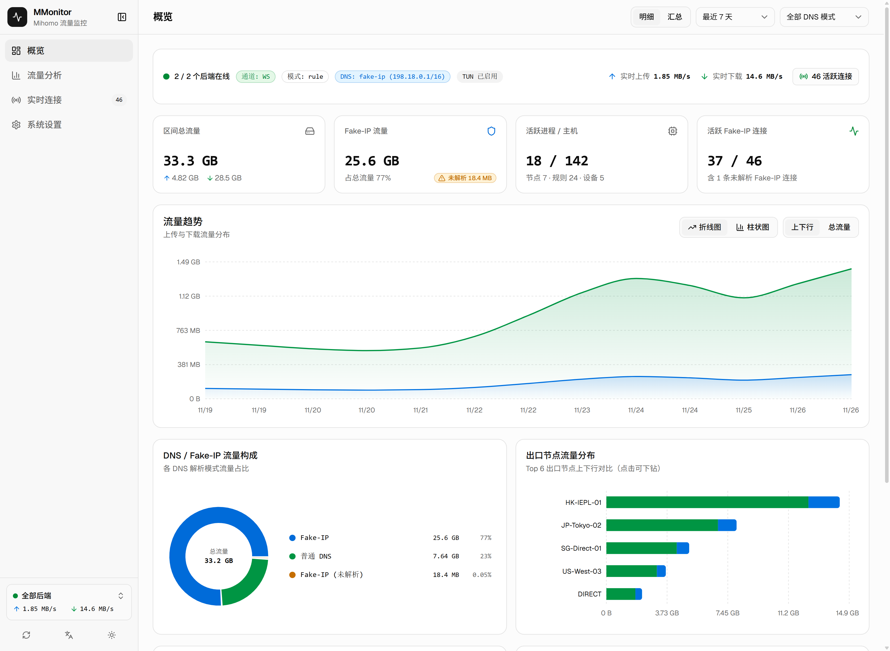

# MMonitor

轻量级、单二进制部署的 **Mihomo 内核流量监控服务**，基于纯 Go（零 CGO + 内嵌 SQLite）与 Shadcn UI (`base-nova`)。



## 功能亮点

- **多后端监控**：同时接入本机 Windows 与局域网软路由等多个 Mihomo 实例，按单后端或全局汇总查看流量。
- **Fake-IP 深度统计**：完整解析 `host`、`sniffHost`、`remoteDestination`、`dnsMode`、`process`，精确统计 Fake-IP 流量占比并标记未解析连接。
- **单连接 WebSocket 实时采集**：每个后端仅维持 1 条 `WS /connections`（1 秒粒度，失败自动降级 HTTP 轮询），低占用、不断联。
- **多维可视化分析**：支持进程 / 主机 / 代理 / 规则 / 设备 / DNS 模式多维图表（折线图/柱状图/环形图）与实时连接管理，内置中英文 i18n 与浅色/暗色主题。
- **永久历史汇总 & 数据管理**：分钟级明细按保留天数自动清理，日级汇总永久保留；支持一键空间回收（`VACUUM`）与自定义日期清理。
- **双形态运行**：Windows 无黑框系统托盘（`HKCU` 用户级开机自启，无需管理员权限）；Linux / OpenWrt / Docker 静态单文件后台服务。

## 快速开始

### Windows 本地运行

下载或编译 `mmonitor-windows-amd64.exe` 直接双击运行：

- 默认监听 `127.0.0.1:8080`，数据保存在程序旁 `data/mmonitor.db`。
- 右键托盘图标可打开面板、开关开机自启（无需管理员权限）或优雅退出。
- 在页面左下角点击「添加后端」填写 Mihomo 地址与 Secret 即可开始统计。

### Docker / 软路由部署

```bash
cp .env.example .env
docker compose up -d
```

OpenWrt / ARM64 软路由直接运行静态单文件：

```bash
chmod +x ./mmonitor-linux-arm64
MIHOMO_URL=http://127.0.0.1:9090 ./mmonitor-linux-arm64
```

### 本地源码编译

```bash
# 1. 构建前端（输出至 web/dist）
cd web && pnpm install && pnpm build

# 2. 编译二进制（零 CGO）
cd ..
CGO_ENABLED=0 GOOS=windows GOARCH=amd64 go build -ldflags="-s -w -H=windowsgui" -o mmonitor.exe .
CGO_ENABLED=0 GOOS=linux   GOARCH=arm64 go build -ldflags="-s -w" -o mmonitor-linux-arm64 .
```

## 常用环境变量

| 变量名                    | 默认值                                                     | 说明                                      |
| ------------------------- | ---------------------------------------------------------- | ----------------------------------------- |
| `MIHOMO_URL`              | 空                                                         | 可选，启动时自动添加/同步默认 Mihomo 后端 |
| `MIHOMO_SECRET`           | 空                                                         | 可选，默认后端的 Bearer Token             |
| `MMONITOR_LISTEN`         | Win: `127.0.0.1:8080`；其他: `:8080`                       | HTTP 监听地址                             |
| `MMONITOR_DB`             | Win: `<exe>/data/mmonitor.db`；Docker: `/data/mmonitor.db` | SQLite 数据库路径                         |
| `MMONITOR_RETENTION_DAYS` | `30`                                                       | 分钟级明细保留天数（日级汇总永久保留）    |
| `MMONITOR_ALLOWED_ORIGIN` | 空（仅同源）                                               | 可选 CORS 允许源                          |

## 发布

推送 `vX.Y.Z` 标签触发 GitHub Actions 自动构建全平台静态二进制与多架构 Docker 镜像（GHCR）。

## License

[AGPL-3.0](LICENSE)
